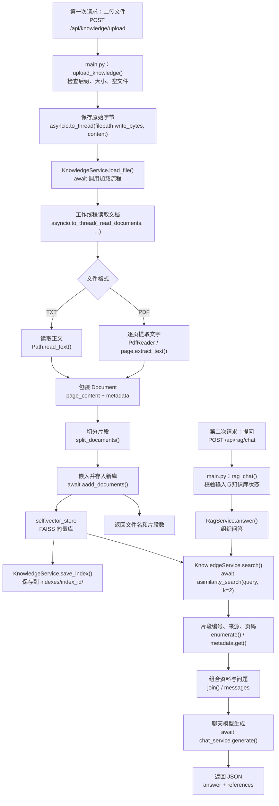

# TXT / PDF 上传与 RAG 问答流程讲解

对应你自己的 `客服Agent练习` 代码，整理日期：2026-10-22。与 [会话管理流程讲解](会话管理流程讲解.md) 分开阅读：当前 RAG 问答还没有自动接入会话历史。

文件链接使用相对路径，可在 VS Code Markdown 预览中点击；`#L数字` 对应编写时的行号，后续编辑可能移动。

## 1. 当前已经完成什么

选择 TXT 或可提取文字的 PDF，上传后建立 FAISS 向量库并保存到 `indexes/<index_id>/`；提问时按 index_id 选择资料，检索原文，将问题与资料交给聊天模型，返回回答、文件来源、PDF 页码和参考片段。

这是固定的 RAG 处理流程，暂时没有让 Agent 自主选择检索工具。

## 2. 文件和函数导航

| 文件或函数 | 职责 |
|---|---|
| [main.py：服务对象创建](main.py#L50) | 创建 KnowledgeService，并把同一个对象传给 RagService |
| [upload_knowledge()](main.py#L298) | 接收上传，检查文件，保存原始字节，再调用加载方法 |
| [load_knowledge()](main.py#L252) | 另一个入口：加载固定的机器人测试 TXT，不需要上传 |
| [rag_chat()](main.py#L273) | 校验问题、检查知识库是否就绪，调用 RAG 服务 |
| [KnowledgeService.__init__()](app/services/knowledge_service.py#L14) | 准备嵌入模型客户端和分割器 |
| [KnowledgeService.load_file()](app/services/knowledge_service.py#L29) | 组织读取、分割、向量化并替换当前知识库 |
| [KnowledgeService._read_documents()](app/services/knowledge_service.py#L56) | 根据后缀读取 TXT 或 PDF，返回 Document 列表 |
| [KnowledgeService.search()](app/services/knowledge_service.py#L48) | 根据问题执行相似检索，返回相关片段 |
| [RagService.answer()](app/services/rag_service.py#L9) | 检索、整理参考资料、请求聊天模型、返回结果 |
| [OllamaService.generate()](app/services/ollama_service.py#L16) | 向 Ollama 请求完整回答，返回字符串 |
| [llm_factory.py](app/services/llm_factory.py) | 创建聊天服务；当前实际实现固定返回 OllamaService |
| [config.py](app/core/config.py) | 提供项目根目录、Ollama 地址等配置 |

## 3. 两次请求，两个阶段

上传和提问是两次独立的 HTTP 请求。先上传建库成功，再执行问答；提问接口不会自动加载磁盘上的文件。



## 4. 上传接口做了什么

入口：[upload_knowledge()](main.py#L298)。请求接收的是文件，不是 JSON：

```python
async def upload_knowledge(file: UploadFile = File(...)):
```

关键步骤：

1. 从 `file.filename` 判断 `.txt` 或 `.pdf`，其他格式返回 422。
2. 最多读取 10MB 加一个字节；超限返回 413，空文件返回 422。
3. 使用随机文件名加实际后缀，保存到项目 `uploads/`，避免同名覆盖或直接使用用户路径。
4. 调用 `await knowledge_service.load_file(filepath, source_name=filename)`。
5. 成功后返回原始文件名和片段数量。

```python
filepath = upload_dir / f"{uuid4().hex}{suffix}"
await asyncio.to_thread(filepath.write_bytes, content)
```

示例变量名为 `suffix`；当前代码实际使用的 `suffidx` 名称虽有拼写差异，只要前后一致也能执行。

为什么保存字节？PDF 包含布局、字体、压缩数据等，不能把整个文件当 UTF-8 文字解码。TXT 的编码解析交给读取方法处理。

原始文件名通过 `source_name` 用于显示；随机名用于服务器保存。这两个用途不同。

## 5. 文件如何变成 Document

入口：[_read_documents()](app/services/knowledge_service.py#L56)。

TXT：

```python
text = filepath.read_text(encoding="utf-8-sig")
Document(page_content=text, metadata={"source": source})
```

PDF：

```python
reader = PdfReader(filepath)
for page_number, page in enumerate(reader.pages, start=1):
    text = page.extract_text() or ""
    # 有正文的页面包装成 Document
```

PDF 元数据类似：

```python
{"source": "使用说明.pdf", "page": 3}
```

页码从 1 开始，表示 PDF 文件中的第几个页面，不一定等于页面印刷的页码。空白页跳过；整份未提取到文字时明确报错。扫描图片型 PDF 暂无 OCR 支持。

`Document` 不是 PDF 本身，它只是“正文＋附加信息”的统一对象。文件格式不同，读取方式不同，后续处理可以共用。

## 6. 加载方法怎样建库

入口：[load_file()](app/services/knowledge_service.py#L29)。

```python
documents = await asyncio.to_thread(
    self._read_documents, filepath, source_name
)
chunks = self.spliter.split_documents(documents)
new_store = await FAISS.afrom_documents(chunks, self.embedding)
self.vector_store = new_store
```

每一步的对象变化：

```text
文件路径
  → list[Document]：TXT 正文或 PDF 页面
  → list[Document]：切分后的片段，保留来源、页码
  → 片段正文转换为向量，连同原文和元数据存入新库
  → 新库建立成功后，替换 self.vector_store
```

使用 `new_store` 是为了先构建成功再赋值。`IndexingService.create_index()` 每次创建独立的 KnowledgeService 和 index_id，然后调用 `save_index()` 保存；不同上传文件互不覆盖。

`aadd_documents()` 是库提供的异步入库方法；`asyncio.to_thread()` 则是让同步文件解析在工作线程执行。两者不是同一种机制，不是任意同步方法前面加 `await` 就能异步。

## 7. 检索找的是原文，不是答案

入口：[search()](app/services/knowledge_service.py#L48)。

```python
return await self.vector_store.asimilarity_search(query, k=k)
```

向量库使用同一个嵌入模型将问题转换为向量，与片段向量比较，返回相关的 `Document` 列表。

- `k=2`：最多取两个片段。
- 不是关键词必须完全相同。
- 没有设置相似度阈值，最接近的片段也可能不足以回答。
- 元数据用于说明来源；当前嵌入的是正文，不是自动把所有元数据也向量化。

## 8. RAG 怎样生成答案并显示页码

入口：[RagService.answer()](app/services/rag_service.py#L9)。

首先调用 `knowledge_service.search(question, k=2)`，给返回片段编号。

```python
source = doc.metadata.get("source", "未知来源")
page = doc.metadata.get("page")
location = f"，第{page}页" if page is not None else ""
```

发送给模型的参考资料类似：

```text
【资料1】来源：使用说明.pdf，第3页
检索到的原文……
```

TXT 没有页码，就不拼“第几页”。然后将资料拼成 `context`，与问题放进消息列表：

```python
messages = [
    {"role": "system", "content": "仅根据资料回答；资料不足时说明……"},
    {"role": "user", "content": f"参考资料：\n{context}\n\n用户问题：{question}"},
]
answer = await self.chat_service.generate(messages)
```

最后返回：

```json
{
  "answer": "根据资料生成的回答……【资料1】",
  "references": [
    {
      "number": 1,
      "source": "使用说明.pdf",
      "page": 3,
      "content": "检索到的原文……"
    }
  ]
}
```

TXT 的 `page` 为 `null`，不编造页码。`references` 是检索结果清单，不表示模型用了其中每一条，也不能自动证明回答没有编造。

## 9. 为什么必须共用 KnowledgeService 对象

[main.py 的初始化](main.py#L50)：

```python
knowledge_service = KnowledgeService()
rag_service = RagService(knowledge_service)
```

上传接口往这个对象的 `self.vector_store` 放资料；RAG 从同一个对象读取。若 RAG 内部另建一个全新 `KnowledgeService()`，新对象的库是空的，不会自动获得已上传的资料。

创建对象时只是准备模型客户端和分割器，还没有读取文件或请求嵌入模型。

## 10. 实际测试顺序

在项目根目录启动服务，保持 Ollama 开启：

```powershell
& "C:\Users\l\anaconda3\envs\yang_3_9\python.exe" -m uvicorn main:app --reload --port 8001
```

打开 [接口文档](http://127.0.0.1:8001/docs)。

1. POST `/api/knowledge/upload` → Try it out → 选择 TXT 或 PDF → Execute。
2. 确认返回上传成功和非零片段数量。
3. POST `/api/rag/chat`，提交 `{"index_id": "上传返回的index_id", "question": "为什么扫地机器人有时会迷路？"}`。
4. 核对回答是否能由参考片段支持。
5. PDF 检查 `references` 中的原文件名和 `page`；TXT 的 `page` 应为 `null`。

服务重启后内存缓存清空，但磁盘索引保留。使用同一个 index_id 提问时，`IndexingService.get_index()` 会调用 `KnowledgeService.load_index()` 读取，无需重新生成资料向量。此次修改之前创建的内存索引没有存盘，需要重新上传一次。

固定加载接口 `/api/knowledge/load` 是另一种准备资料的方式，只加载 `data/机器人测试说明.txt`，同样返回一个新的 index_id。

## 11. 与聊天数据库的关系及当前边界

| 位置 | 保存什么 | 重启后是否保留 |
|---|---|---|
| SQLite 的 conversations / messages 表 | 会话标题和聊天记录 | 已提交数据保留 |
| uploads/ | 上传文件的原始字节 | 文件保留 |
| KnowledgeService.vector_store | 当前文件的 FAISS 向量库内存对象 | 内存对象不保留，按 index_id 从磁盘读取 |
| indexes/<index_id>/ | index.faiss 保存向量；index.pkl 保存片段、元数据及映射 | 保留 |

当前已支持按 index_id 选择独立索引及索引持久化。`/api/rag/chat` 不读取、保存会话历史，不会自动调用 Agent，也没有 OCR。上传失败时磁盘上可能仍留下原始文件，但不代表新库已建立成功。

`FAISS.load_local(..., allow_dangerous_deserialization=True)` 用于读取本服务生成的 index.pkl；这里只加载服务器自己的索引文件，不提供外部索引文件上传接口。课程使用原生 FAISS 加 JSON；本项目使用 LangChain FAISS 封装加本地保存，保留原来的 Ollama 向量模型。

PDF 的文字提取和小片段切分可能损失布局、表格关系、问题与答案的关联；检索有相关结果也不保证足以回答。提示词要求依据资料，但仍需核对实际输出。

上传前检查 Git 暂存列表，不提交 `.env`、`uploads/`、`indexes/`、聊天数据库和缓存。

## 12. 复习只抓两条路线

```text
入库：上传 → 保存文件 → 解析文字 → Document → 切分 → 嵌入 → FAISS → save_index() 存盘

问答：问题 → 相似检索 → 原文与来源 → 组成消息 → 聊天模型 → 回答与参考片段
```

对应职责：`main.py` 接请求，`KnowledgeService` 找资料，`RagService` 组织资料和回答，聊天服务实际调用模型。
