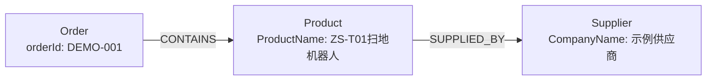

# 机器人知识库客服 Agent

以机器人说明资料和虚构订单数据为测试场景，实现支持文档检索、图数据库查询、图片描述和多轮对话的客服后端。

## 功能

- 普通聊天和文本 Agent 均支持流式输出；Agent 流正常结束后保存完整问答。
- SQLite 保存会话标题和聊天历史。
- 上传 TXT、可提取文字的 PDF，解析并切分资料。
- 使用 Ollama 生成向量，通过 FAISS 检索相关片段。
- 按 index_id 管理独立知识库，索引保存到磁盘。
- RAG 接口返回回答、参考片段和 PDF 页码。
- LangGraph Agent 根据模型工具请求执行检索，支持多轮对话。
- 支持 JPG/PNG 图片描述，LangGraph 按是否有图片选择处理分支；图片接口目前整段返回。
- 支持根据订单号执行固定的 Neo4j 参数化查询。
- 支持 Text2Cypher：根据图结构和示例生成 Cypher，并使用只读账号执行。

## 技术栈

Python、FastAPI、aiohttp、SQLAlchemy、SQLite、
Ollama、LangChain、FAISS、LangGraph、Neo4j、pypdf。

当前验证环境为 Windows、Python 3.11.17。

聊天模型：qwen3.5:9b  
向量模型：qwen3-embedding:4b

当前聊天工厂固定使用 Ollama；DeepSeek 服务代码尚未接入工厂切换。

## 核心流程

```text
用户问题 + 会话 ID + 知识库 ID
    ↓
从 SQLite 读取聊天历史
    ↓
模型节点：直接回答，或提出工具调用请求
    ├─ 无工具请求 → 结束
    └─ 有工具请求
          ↓
       工具节点：选择 FAISS 检索、固定 Neo4j 查询或 Text2Cypher
          ↓
       执行结果加入消息列表
          ↓
       回到模型节点，继续处理
    ↓
保存本轮问答，返回回答
```

RAG 接口固定先检索；Agent 接口由模型决定是否请求检索工具。

文本流式接口在生成过程中逐段发送文字，图正常结束后将完整输出保存到 SQLite。

图片分支单独接收图片和问题：

```text
POST /api/chat/image → 图的入口判断 → image_node → Ollama 图片问答 → 返回回答
```

当前图片分支不联合检索知识库，也不保存图片对话历史。

## 主要文件

| 文件 | 作用 |
|---|---|
| main.py | FastAPI 路由和请求模型 |
| app/core/config.py | 配置读取 |
| app/core/database.py | 数据库连接和会话工厂 |
| app/models/ | 会话表、消息表定义 |
| app/services/ollama_service.py | 普通、流式、工具调用及图片请求 |
| app/services/conversation_service.py | 会话与聊天历史读写 |
| app/services/knowledge_service.py | 文件解析、切分、FAISS 建库与检索 |
| app/services/indexing_service.py | 按 ID 创建和获取知识库 |
| app/services/rag_service.py | 固定检索后生成带来源的回答 |
| app/services/graph_service.py | LangGraph 节点、路由及工具循环 |
| app/services/neo4j_service.py | 固定订单查询、Cypher 生成及只读执行 |
| tools/definitions.py | 模型可用的工具说明 |
| data/neo4j_demo.cypher | 虚构订单、商品及供应商的初始化数据 |

agent_service.py 保留早期普通 Python 工具调用实现；
当前 Agent 接口使用 graph_service.py。

## 本地运行

需要安装并运行 Ollama，下载模型：

```powershell
ollama pull qwen3.5:9b
ollama pull qwen3-embedding:4b
```

在 Python 环境中安装依赖：

```powershell
python -m pip install fastapi "uvicorn[standard]" aiohttp pydantic-settings sqlalchemy aiosqlite langgraph langchain-core langchain-community langchain-ollama langchain-text-splitters faiss-cpu pypdf python-multipart neo4j
```

在项目根目录创建 `.env`：

```dotenv
OLLAMA_BASE_URL=http://127.0.0.1:11434
OLLAMA_CHAT_MODEL=qwen3.5:9b

NEO4J_URL=neo4j://127.0.0.1:7687
NEO4J_USERNAME=neo4j
NEO4J_PASSWORD=填写管理员密码
NEO4J_DATABASE=neo4j
NEO4J_READ_USERNAME=agent_reader
NEO4J_READ_PASSWORD=填写只读账号密码
```

密码项需要替换为本机设置的密码；真实密码只放在本地 `.env`，不提交到 Git。
图查询账号和演示数据按下文“Neo4j 数据准备”配置。

向量模型名称目前在 knowledge_service.py 中配置。文档问答需要 Ollama 运行；
使用图查询工具时，还需要 Neo4j 数据库实例处于 Running。

在项目根目录启动：

```powershell
python -m uvicorn main:app --reload --port 8001
```

接口文档：[http://127.0.0.1:8001/docs](http://127.0.0.1:8001/docs)

启动时会自动创建缺少的数据库表。
上述依赖清单依据当前代码整理，尚未验证全新环境安装。

## 演示步骤

1. 调用 `POST /api/knowledge/load`，加载内置机器人测试资料，
   记录返回的 `index_id`。
   也可以通过 `POST /api/knowledge/upload` 上传 TXT/PDF。

2. 调用 `POST /api/conversations`：

```json
{"title": "机器人客服演示"}
```

记录返回的 `id`，作为 `conversation_id`。

3. 调用 `POST /api/agent/chat`：

```json
{
  "conversation_id": "替换成会话ID",
  "index_id": "替换成知识库ID",
  "question": "ZS-T01出现E731错误怎么处理？"
}
```

4. 保持会话 ID 不变继续提问，即可使用历史上下文。

5. 调用 `GET /api/conversations/{conversation_id}/messages`
   查看已保存的问答。

### 流式与图片接口

| 接口 | 请求方式 | 返回内容 |
|---|---|---|
| `POST /api/agent/chat` | JSON：conversation_id、index_id、question | JSON 回答 |
| `POST /api/agent/chat/stream` | 与普通 Agent 接口相同的 JSON | 逐段返回的纯文本 |
| `POST /api/chat/image` | multipart/form-data：file、question | JSON 图片描述 |

观察流式效果可使用 `curl -N`；Swagger 页面可能等完整响应结束后才显示结果。
图片接口可以上传 [测试图片](data/robot-vision-test.png)，询问“图片里是什么设备，顶部放着什么？”。
该图片由 AI 生成，只用于视觉功能演示，不代表真实产品或故障证据。

数据库位于 data/chat.sqlite3，上传文件位于 uploads/，
FAISS 索引位于 indexes/。这些运行数据不提交到 Git。

## Neo4j 数据准备

1. 在 Neo4j Desktop 中创建并启动本地实例。
2. 以管理员用户连接，在 `neo4j` 数据库中执行
   [data/neo4j_demo.cypher](data/neo4j_demo.cypher)，创建三个节点和两条关系。
3. 切换到 `system` 数据库，创建供 Text2Cypher 使用的只读账号。
   将下面的密码占位内容替换为自己的密码，然后分别执行两条命令：

```cypher
CREATE USER agent_reader IF NOT EXISTS
SET PASSWORD '替换成自己的密码'
CHANGE NOT REQUIRED;
```

```cypher
GRANT ROLE reader TO agent_reader;
```

已有该账号时使用它的现有密码；`IF NOT EXISTS` 不会重置已有账号的密码。
将其密码填入 `.env` 的 `NEO4J_READ_PASSWORD`，与管理员密码配置分开。

演示数据的关系为：



每次演示前确认数据库实例为 Running；只打开 Desktop 窗口不代表数据库已启动。

## 图查询工具

| 工具 | 用途 | 实现方式 |
|---|---|---|
| `search_knowledge` | 机器人故障、维护及售后资料 | FAISS 相似检索 |
| `query_order_supplier` | 按订单号查询商品及供应商 | 预定义 Cypher，参数化传入订单号 |
| `query_graph` | 查询订单、商品、供应商之间的其他关系 | 模型生成 Cypher，使用只读账号执行 |

使用原来的 `/api/agent/chat` 或其流式接口，保持请求格式不变，只替换问题：

- 固定查询示例：“订单 DEMO-001 包含什么商品，由谁提供？”
- Text2Cypher 示例：“示例供应商供应了哪些商品？”

当前 Schema 由提示词手工描述，仅包含 `Order.orderId`、`Product.ProductName`、
`Supplier.CompanyName` 和 `CONTAINS`、`SUPPLIED_BY` 两类关系。
它不包含库存、价格或物流状态等字段。

Neo4j 服务也可以单独运行，生成查询并执行：

```powershell
python -X utf8 -m app.services.neo4j_service
```

普通聊天工厂和文本 Agent 当前都使用 Ollama。
这是预定义图查询与 Text2Cypher 的学习实现，不是 Microsoft GraphRAG。

## 已完成的人工验证

| 场景 | 观察结果 |
|---|---|
| E731 故障处理 | 返回资料中的故障原因和四个步骤 |
| 滤网清洁周期 | 正确回答累计运行37小时 |
| 售后服务时间 | 正确回答工作日9:30至17:30 |
| 多轮上下文 | 能从前一轮消息找回机器人昵称“小绿” |
| 索引恢复 | 服务重启后，同一 index_id 可继续检索 |
| 未知故障码 E999 | 原先编造电池故障；加强资料依据要求后，观察到明确拒答 |
| Agent 流式输出 | 终端收到回答，结束后可从消息接口查到完整问答 |
| 图片分支 | 返回扫地机器人和抹布等可见内容；也曾误判顶部部件用途 |
| 固定图查询 | 按 DEMO-001 查询到商品“ZS-T01扫地机器人”和供应商“示例供应商” |
| Text2Cypher | 观察到关系方向错误、漏条件和误判 UNSUPPORTED；补充规则及示例、降低生成随机性后，干净历史下的供应商查询跑通 |

这些是少量人工验证结果，不代表系统准确率或稳定性统计。

## 当前不足

- 模型可能添加资料未支持的内容，提示词不能保证消除幻觉。
- 图片中部件用途、品牌型号等判断仍可能出错，图片描述不能作为内部故障诊断。
- 当前默认检索 top-2，没有相关性阈值和重排序。
- 不支持扫描版 PDF 的 OCR。
- 每轮读取完整聊天历史，尚未实现长对话裁剪。
- 历史中的错误回答可能影响后续工具选择和回答；修改提示词不会自动清除旧历史。
- Agent 接口目前只返回回答；参考片段和页码由 RAG 接口返回。
- Text2Cypher 的只读权限限制写入，但不保证查询语义正确；当前没有完善的语义校验或自动纠错。
- 图结构由提示词手工维护，数据结构变化后需要同步更新。
- 尚未进行并发、性能和大规模效果评估。
