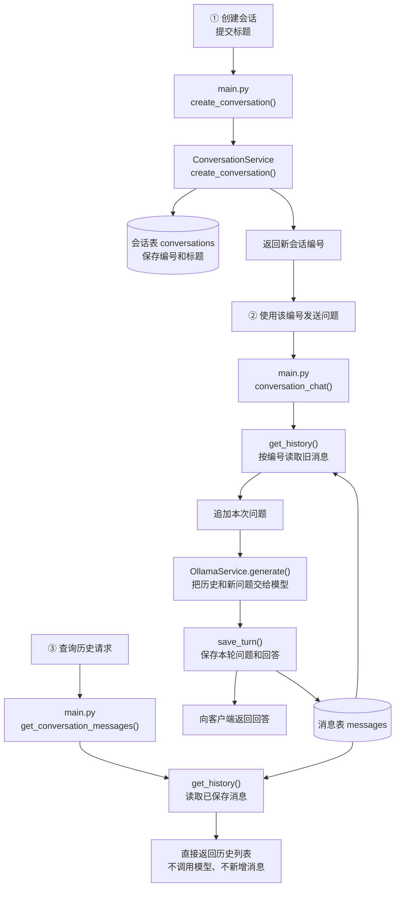
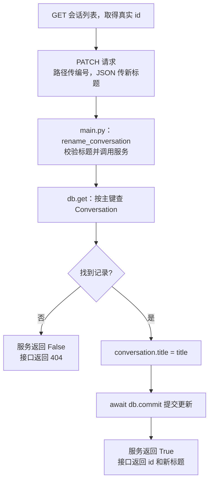

# 会话管理流程讲解

本文对应 `D:\project-ai\客服Agent练习` 当前代码（2026-10-21），不是课程参考目录。

用一个例子理解整个流程：**新建“机器人昵称咨询” → 聊两句 → 查看历史 → 重启后再查看。** 本文只整理已有功能，不新增代码。

文档链接使用相对路径，可在 VS Code Markdown 预览中点击打开。行号对应编写时的版本，后续编辑可能移动。

## 一、先看整体流程



创建会话、发送问题、查询历史是三次不同的 HTTP 请求，不是点击一次就全部自动执行。两处 `get_history()` 表示同一个方法在不同请求中被复用。

## 二、各个文件负责什么

| 文件 | 职责 |
|---|---|
| [main.py](main.py) | 定义接口，校验请求，安排调用顺序，返回结果 |
| [conversation_service.py](app/services/conversation_service.py) | 创建会话、读写消息、查询会话列表、清空消息 |
| [conversation.py](app/models/conversation.py) | 定义会话表：编号、标题 |
| [message.py](app/models/message.py) | 定义消息表：编号、所属会话、角色、正文 |
| [database.py](app/core/database.py) | 配置数据库地址、引擎、数据库会话工厂和 Base |
| [ollama_service.py](app/services/ollama_service.py) | 向 Ollama 发送消息，读取模型回答 |
| [llm_factory.py](app/services/llm_factory.py) | 创建聊天服务；当前实现返回 OllamaService |

两个“会话”不要混淆：

- `conversation_id`：用户的哪一段聊天。
- 数据库 Session，也就是代码里的 `db`：执行数据库操作使用的工作单元，不是聊天本身。

## 三、服务启动：准备数据库

入口：[main.py → lifespan()](main.py#L22)。

```python
async with engine.begin() as connection:
    await connection.run_sync(Base.metadata.create_all)
```

根据已经导入的模型定义，创建缺少的数据表：

- [Conversation 模型](app/models/conversation.py#L7)：`conversations` 表，保存会话编号和标题。
- [Message 模型](app/models/message.py#L6)：`messages` 表，保存每条消息的内容与归属。

数据库连接配置在 [database.py](app/core/database.py#L22)。当前 SQLite 文件路径由 `ROOT_DIR / "data" / "chat.sqlite3"` 确定。

这一步在服务启动时执行，不是每收到一句话就重新建表。`create_all` 不清空旧记录，也不自动迁移已有表结构。服务关闭时，`lifespan` 的 `finally` 调用 `engine.dispose()` 释放连接资源。

## 四、创建会话：只保存编号和标题

请求：

```text
POST /api/conversations
```

请求 JSON：

```json
{"title": "机器人昵称咨询"}
```

### 1. 接口接收标题

进入 [main.py → create_conversation()](main.py#L198)。

函数先用 `strip()` 清理标题首尾空白，检查不能是空标题，再调用：

```python
return await conversation_service.create_conversation(title)
```

### 2. 服务创建并保存记录

进入 [ConversationService.create_conversation()](app/services/conversation_service.py#L107)：

```python
conversation = Conversation(
    id=uuid4().hex,
    title=title,
)

db.add(conversation)
await db.commit()
```

- `uuid4().hex`：生成随机编号。
- `Conversation(...)`：创建代表会话记录的 Python 对象。
- `db.add(...)`：在数据库会话中登记待插入对象。
- `await db.commit()`：提交保存。

假设用 `abc123` 代表实际返回的编号，会话表增加：

| id | title |
|---|---|
| abc123 | 机器人昵称咨询 |

这里的 `abc123` 只是讲解用的简写。实际测试必须复制接口返回的完整 `id`。

此时消息表没有新增内容，也没有调用模型。创建接口只返回会话信息，调用者要保留编号，后续请求再传回来。

## 五、第一轮聊天：读取、回答、保存

请求：

```text
POST /api/conversations/chat
```

```json
{
  "conversation_id": "abc123",
  "question": "我的机器人叫小绿，请记住。"
}
```

入口：[main.py → conversation_chat()](main.py#L100)。

### 1. 读取历史

```python
messages = await conversation_service.get_history(
    request.conversation_id
)
```

进入 [ConversationService.get_history()](app/services/conversation_service.py#L33)：

```python
async with AsyncSessionLocal() as db:
    statement = (
        select(Message)
        .where(Message.conversation_id == conversation_id)
        .order_by(Message.id)
    )

    result = await db.execute(statement)
    messages = result.scalars().all()
```

按顺序理解：

1. `AsyncSessionLocal()` 创建数据库操作会话 `db`。
2. `select(Message)` 选择消息表中的消息对象。
3. `where(...)` 限定会话编号，不查询其他会话的消息。
4. `order_by(Message.id)` 按消息编号升序排列，保持插入顺序。
5. `db.execute(statement)` 执行查询。
6. `scalars().all()` 从查询结果中收集 `Message` 对象。

随后将对象转换为普通字典列表：

```python
return [
    {"role": message.role, "content": message.content}
    for message in messages
]
```

因为新会话没有消息，本次返回 `[]`。

### 2. 追加新问题

回到 [main.py 的消息追加位置](main.py#L113)：

```python
messages.append({
    "role": "user",
    "content": question,
})
```

列表变成：

```python
[
    {"role": "user", "content": "我的机器人叫小绿，请记住。"}
]
```

这里只修改本次请求使用的 Python 列表，没有往数据库插入记录。

### 3. 调用模型

[main.py 中的调用位置](main.py#L125)：

```python
answer = await chat_service.generate(messages)
```

进入 [OllamaService.generate()](app/services/ollama_service.py#L16)，将消息放入 HTTP 请求发给 Ollama：

```python
json={
    "model": self.chat_model,
    "messages": messages,
    "stream": False,
    "think": False,
}
```

服务检查 HTTP 状态，解析响应 JSON，提取 `result["message"]["content"]`，将回答字符串交回接口，例如“好的，记住了。”。

这一步生成回答，还没有保存新消息。当前普通会话接口使用非流式 `generate()`；已有的 `/api/chat/stream` 是另一条接口，不会自动经过这里的历史读写逻辑。

### 4. 保存本轮问答

[main.py 的保存位置](main.py#L139)：

```python
await conversation_service.save_turn(
    request.conversation_id,
    question,
    answer,
)
```

进入 [ConversationService.save_turn()](app/services/conversation_service.py#L55)：

```python
db.add_all([
    Message(
        conversation_id=conversation_id,
        role="user",
        content=question,
    ),
    Message(
        conversation_id=conversation_id,
        role="assistant",
        content=answer,
    ),
])

await db.commit()
```

消息表增加两行，消息自己的主键 `id` 自动生成：

| conversation_id | role | content |
|---|---|---|
| abc123 | user | 我的机器人叫小绿，请记住。 |
| abc123 | assistant | 好的，记住了。 |

这里只保存新增的一问一答，不重复保存之前的历史。模型调用失败或返回空白回答时，当前接口不会执行这一步。

### 5. 返回客户端

接口返回：

```python
return {
    "conversation_id": request.conversation_id,
    "answer": answer,
}
```

FastAPI 将字典转换为 JSON 发送给调用者。

## 六、第二轮聊天：为什么能记住“小绿”

使用同一编号请求：

```json
{
  "conversation_id": "abc123",
  "question": "它叫什么？"
}
```

仍进入同一个 `conversation_chat()`，但 `get_history()` 现在查到两条旧消息。

追加问题后，模型实际收到：

```python
[
    {"role": "user", "content": "我的机器人叫小绿，请记住。"},
    {"role": "assistant", "content": "好的，记住了。"},
    {"role": "user", "content": "它叫什么？"},
]
```

所以模型有上下文回答“小绿”。它不是修改了自己的参数，而是再次收到了旧消息。

成功后只保存新的一轮：

| conversation_id | role | content |
|---|---|---|
| abc123 | user | 它叫什么？ |
| abc123 | assistant | 它叫小绿。 |

现在这段会话有四条消息。

## 七、查询历史：不再调用模型

请求：

```text
GET /api/conversations/abc123/messages
```

进入 [main.py → get_conversation_messages()](main.py#L150)：

```python
messages = await conversation_service.get_history(conversation_id)

return {
    "conversation_id": conversation_id,
    "messages": messages,
}
```

它复用读取方法，直接返回数据库记录：

```text
收到编号 → 查询消息表 → 转成字典列表 → 返回 JSON
```

不会调用 `generate()`，不会产生新回答，也不会保存新消息。服务重启后，只要仍连接同一个数据库文件，记录就可以继续查询。

## 八、列出会话与清空消息

### 列出会话

- 接口：[main.py → list_conversations()](main.py#L189)
- 服务：[ConversationService.list_conversations()](app/services/conversation_service.py#L92)
- 路径：`GET /api/conversations`

当前查询会话表：

```python
select(Conversation).order_by(Conversation.id)
```

返回会话编号和标题，供页面左侧显示列表。这里按编号排序，不是按距离或创建时间排序。

### 清空消息

- 接口：[main.py → clear_conversation_messages()](main.py#L167)
- 服务：[ConversationService.clear_history()](app/services/conversation_service.py#L77)
- 路径：`DELETE /api/conversations/{conversation_id}/messages`

核心代码：

```python
statement = delete(Message).where(
    Message.conversation_id == conversation_id
)
await db.execute(statement)
await db.commit()
```

只删除消息表中该会话的消息。不要省略 `where`，否则删除范围会变为整张消息表。

当前不删除会话表记录，所以清空消息后，标题仍能保留在会话列表里。这与“删除整个会话”不是同一个功能。

## 九、修改会话标题（后续新增功能）

这部分是创建讲义后新增的功能。修改会话表的标题，不修改会话编号，也不修改消息正文。

- 请求模型：[main.py → RenameConversationRequest](main.py#L208)
- 接口函数：[main.py → rename_conversation()](main.py#L212)
- 服务函数：[ConversationService.rename_conversation()](app/services/conversation_service.py#L120)
- 路径：`PATCH /api/conversations/{conversation_id}/title`



### 1. 路径参数和请求体分别传什么

先打开 [会话列表](http://127.0.0.1:8001/api/conversations)，找到实际返回的记录：

```json
{
  "conversations": [
    {"id": "实际生成的编号", "title": "机器人昵称咨询"}
  ]
}
```

复制 `id` 的值，不含双引号。在 `/docs` 的 PATCH 接口中：

- `conversation_id` 输入框：填刚复制的编号。
- Request body：填 `{"title": "小绿的使用咨询"}`。

这里列表返回的字段名 `id`，与路径参数 `conversation_id` 指的是同一个会话编号。

### 2. 服务层怎样执行更新

```python
async def rename_conversation(self, conversation_id: str, title: str) -> bool:
    async with AsyncSessionLocal() as db:
        conversation = await db.get(Conversation, conversation_id)

        if conversation is None:
            return False

        conversation.title = title
        await db.commit()
        return True
```

- `db.get(Conversation, conversation_id)`：根据会话表主键查一条记录，不是根据标题查找。
- 找不到返回 `False`，接口据此返回 `404`。
- 找到后直接修改对象属性。对象由当前 `db` 查询出来，SQLAlchemy 会跟踪修改，不需要再 `db.add()`。
- `commit()` 提交后更新正式生效；`True` 是服务给接口的处理结果，不是最终响应 JSON。

接口还会拒绝空白标题；正常返回类似 `{"id": "原来的编号", "title": "小绿的使用咨询"}`。

### 3. 与新增、清空消息的区别

| 操作 | 修改哪张表 | 核心代码 |
|---|---|---|
| 创建会话 | conversations，插入一行 | `db.add(Conversation(...))` |
| 修改标题 | conversations，更新已有行 | `conversation.title = title` |
| 保存问答 | messages，插入两行 | `db.add_all([Message(...), Message(...)])` |
| 清空消息 | messages，删除该会话的消息 | `delete(Message).where(...)` |

这些写操作都需要提交。验证标题修改时，再执行 GET 会话列表，确认标题变化；消息历史应保持不变。

## 十、从网页实际走一遍

在 `D:\project-ai\客服Agent练习` 启动服务，并确保 Ollama 运行：

```powershell
& "C:\Users\l\anaconda3\envs\yang_3_9\python.exe" -m uvicorn main:app --reload --port 8001
```

等待 `Application startup complete.`，打开 [接口文档](http://127.0.0.1:8001/docs)。

1. 在 POST `/api/conversations` 提交标题，复制返回的真实 `id`。
2. 在 POST `/api/conversations/chat` 使用该编号，说“我的机器人叫小绿，请记住”。
3. 同一接口、同一编号，再问“它叫什么”。
4. 使用 GET `/api/conversations/{conversation_id}/messages` 查询，核对四条消息。
5. 在服务终端按 Ctrl+C 停止，再用上面的命令启动。
6. 再查同一编号的历史，确认消息仍在。

7. 在 PATCH 标题接口使用同一个编号修改标题，再 GET 会话列表确认变化。

GET 可以直接用浏览器访问。POST、PATCH、DELETE 使用 `/docs` 的 Try it out 与 Execute 测试，或使用 HTTP 客户端。

### 当前会话接口一览

| 方法 | 路径 | 作用 |
|---|---|---|
| POST | `/api/conversations` | 创建会话，返回编号和标题 |
| GET | `/api/conversations` | 列出会话编号和标题 |
| POST | `/api/conversations/chat` | 读取历史、生成回答、保存新问答 |
| GET | `/api/conversations/{conversation_id}/messages` | 查询已有消息，不调用模型 |
| DELETE | `/api/conversations/{conversation_id}/messages` | 清空消息，保留会话记录 |
| PATCH | `/api/conversations/{conversation_id}/title` | 修改标题，保留编号和消息 |

## 十一、当前实现的边界

- 当前聊天接口尚未检查会话表中是否存在传入的编号。练习时先创建，再用返回的编号聊天。
- 两张表尚未添加外键约束。编号的对应关系目前由应用约定。
- 旧的消息记录不会自动补成会话表记录，旧编号可能不在新会话列表中，但消息仍可按编号查询。
- 暂无登录和权限验证，知道编号即可查询或清空对应消息，当前仅作本地练习。
- 当前读取全部历史，未做分页、长度裁剪，也未处理同一会话的并发聊天顺序。
- 数据库文件不是源码，不应提交 Git；上传前检查 `.gitignore`。

## 十二、最后只记这三句话

> 创建会话：保存编号和标题。
>
> 发送问题：读历史 → 加新问题 → 问模型 → 保存新问答。
>
> 查询历史：直接返回已经保存的消息，不再问模型。

先按一段真实会话对照这些函数，不需要继续增加功能，也不用把所有代码背下来。
